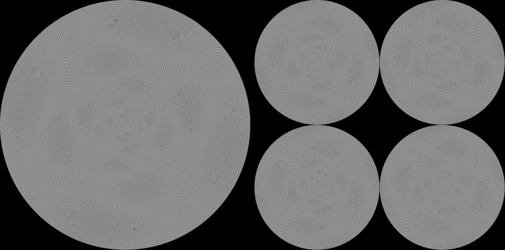
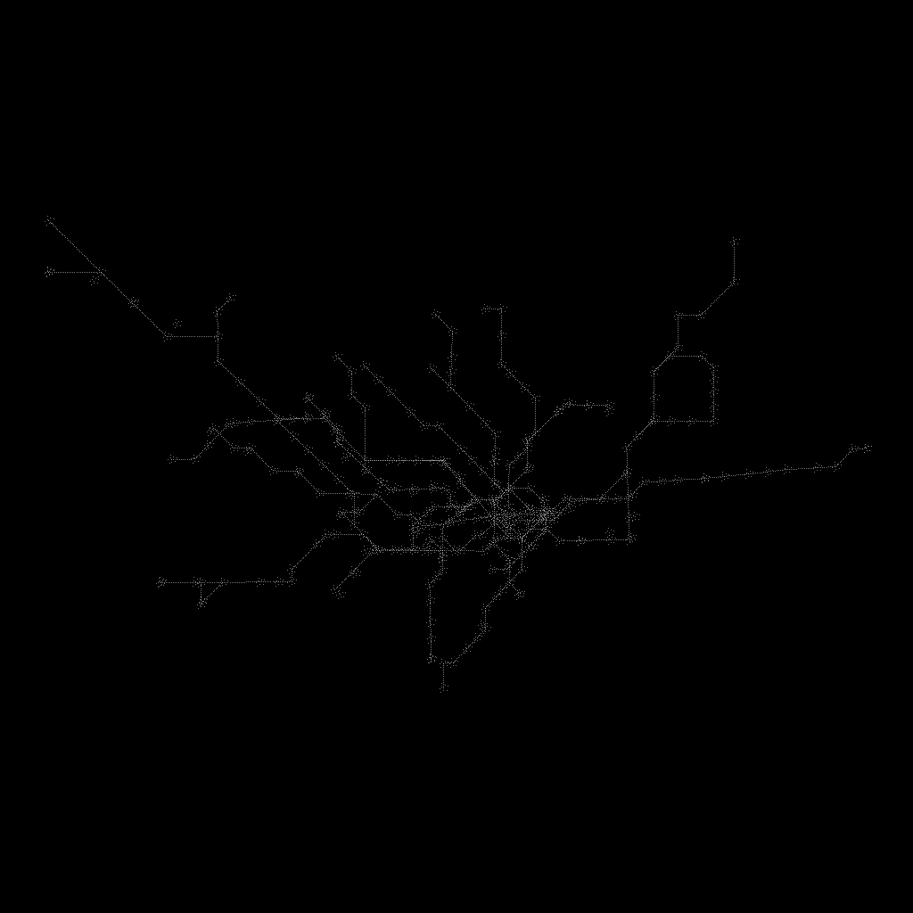

# Latest results: 20261022T1718Z (GitHub-hosted, ubuntu-latest)





```
{
 "layers": 4,
 "particles_per_layer": 262144,
 "particles": 1048576,
 "spiral": {
  "cells_lit": 802553,
  "peak_per_cell": 4,
  "seconds": 0.39
 },
 "stack": {
  "cells_lit": 803052,
  "peak_per_cell": 4,
  "tile_px": 512,
  "seconds": 0.61
 },
 "raster_px": 1024,
 "generated_utc": "2026-10-22T17:17:35Z"
}
{
 "command": "draw underground",
 "source": "https://api.tfl.gov.uk/Line/Mode/tube + /Line/<id>/Route/Sequence/all",
 "attribution": "Powered by TfL Open Data. Contains OS data (c) Crown copyright and database rights 2016 and Geomni UK Map data (c) and database rights 2019.",
 "lines": 11,
 "stations": 341,
 "edges": 314,
 "particles_drawn": 6332,
 "law": "geography then 200 passes of 8-direction edge snapping (step 0.05); edge particles every 0.004; 9 per station",
 "seconds": 15.8,
 "generated_utc": "2026-10-22T17:17:51Z"
}```
